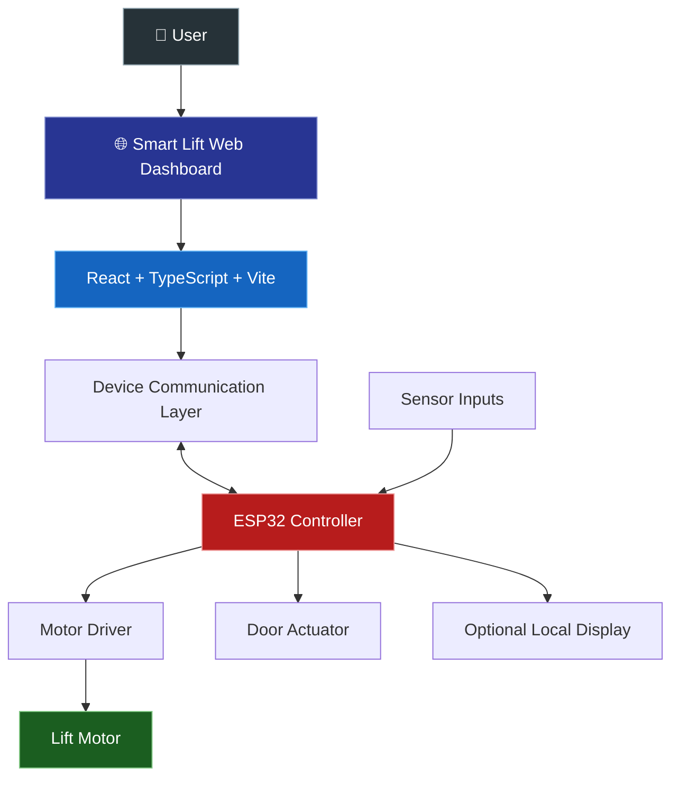

<div align="center">

# 🛗 SMART LIFT
### Intelligent Three-Floor Elevator Control System

**Connecting embedded hardware with an interactive web-based control dashboard.**

<br/>

<a href="https://smart-lift-bay.vercel.app/">
  
</a>
<a href="https://github.com/vaibhavkumar-h/smart-lift">
  
</a>

<br/><br/>


</div>

---

## ✨ Project at a Glance

Smart Lift is an **IoT-based, three-floor elevator prototype** that brings together an ESP32-based embedded controller, physical lift mechanisms, and a modern web dashboard.

The project explores how hardware and software can work together to provide intuitive elevator controls, device-status visibility, and an interactive monitoring experience.

<table>
<tr>
<td width="50%" valign="top">

### 🎯 The Goal

Create an accessible, interactive way to operate and monitor a miniature elevator while demonstrating embedded control, web development, and IoT integration.

</td>
<td width="50%" valign="top">

### 💡 The Approach

Combine a physical three-floor lift prototype with a React and TypeScript dashboard featuring floor selection, movement controls, door controls, and device information.

</td>
</tr>
</table>

> 🌐 **Try it live:** [smart-lift-bay.vercel.app](https://smart-lift-bay.vercel.app/)

---

## 📸 Dashboard Preview

<div align="center">

### A unified interface for lift operation and monitoring

<a href="https://smart-lift-bay.vercel.app/">
  
</a>

<sub>Open the live dashboard to explore the actual interface. Replace this placeholder with a screenshot of your running dashboard for the final project showcase.</sub>

<br/><br/>

<a href="https://smart-lift-bay.vercel.app/">
  
</a>

</div>

---

## 🚀 Features

<table>
<tr>
<td width="50%" valign="top">

### 🎮 Interactive Controls

- 🛗 Three-floor selection — F1, F2, F3
- ⬆️ Move Up control
- ⬇️ Move Down control
- 🚪 Open Door control
- 🏠 Ground Floor control
- 🔌 Device connect/disconnect interface

</td>
<td width="50%" valign="top">

### 📊 Monitoring Interface

- 📍 Current-floor indicator
- 📶 Wi-Fi and connection status
- ⚡ Power-status display
- 🚪 Door-state indicator
- 📈 Travel-progress visualization
- 🖥️ Device and network information
- 🔊 Sound toggle

</td>
</tr>
<tr>
<td width="50%" valign="top">

### 🎨 Visual Experience

- 🌑 Modern dark-themed interface
- 🤖 Integrated 3D visual element
- 🧩 Component-based React architecture
- 🖱️ Interactive dashboard elements

</td>
<td width="50%" valign="top">

### 🔧 Configuration

- 🌐 ESP32 IP-address field
- 🔐 Pairing PIN field
- 📡 Device connection interface
- 🛠️ Frontend development and production builds

</td>
</tr>
</table>

<sub>Dashboard controls and displayed statuses depend on the current application logic, firmware, and device connection. A visible control does not by itself guarantee a verified hardware operation.</sub>

---

## 🧩 Problem Statement

Elevator automation combines physical movement, floor selection, door operation, and controller status. In a prototype, demonstrating these functions clearly can be difficult when the hardware and user interface are separate.

Smart Lift explores a unified approach by connecting an interactive dashboard with an ESP32-based elevator prototype.

### 🎯 Proposed Solution

Develop a web-based control interface for a three-floor lift prototype, supported by embedded hardware that manages the physical system.

The interface brings operation controls and status information into one place, making the prototype easier to demonstrate, inspect, and extend.

### 🌟 What Makes This Project Valuable?

- **Hardware + software integration:** Connects a web application concept with embedded control.
- **Visual monitoring:** Presents floor and device information in a single interface.
- **Modular development:** Uses reusable React components and TypeScript.
- **Extensible design:** Provides a foundation for future telemetry, diagnostics, and secure remote communication.

---

## 🏗️ System Architecture



### 🔄 System Workflow

1. **Connect** — Configure the device address and connection details in the dashboard.
2. **Select** — Choose the desired floor or an available operation.
3. **Communicate** — The frontend sends commands through the configured device communication mechanism.
4. **Control** — The ESP32 firmware processes supported commands and interfaces with the hardware.
5. **Monitor** — The dashboard displays the status information available to the application.

*The diagram represents the intended system architecture. Exact wiring, firmware behavior, feedback paths, and communication endpoints should be verified against the hardware implementation.*

---

## 🔩 Hardware Components

| Component | Role |
|---|---|
| 🧠 ESP32 development board | Embedded control and Wi-Fi connectivity |
| ⚙️ DC motor | Lift movement |
| 🔌 Motor driver module | Motor-control interface |
| 🚪 Servo motor | Door mechanism |
| 📡 Ultrasonic sensor | Distance sensing and potential obstruction detection |
| 🖥️ OLED SSD1306 display | Local status display, where configured |
| 🔋 Power supply | Supplies power to the electronics and actuators |
| 🧰 Mechanical structure and wiring | Physical lift assembly |

**Note:** Confirm the exact component models, quantities, and wiring against your assembled prototype before reproducing the hardware.

---

## 💻 Software Stack

<div align="center">

| Technology | Purpose |
|:---|:---|
| ⚛️ React | User-interface components |
| 🔷 TypeScript | Typed application development |
| ⚡ Vite | Development server and production build |
| 🎨 CSS | Layout, styling, and visual presentation |
| 🤖 Spline integration | 3D visual component |
| 🔴 ESP32 firmware | Embedded device control |
| ▲ Vercel | Frontend hosting |
| 🐙 Git & GitHub | Version control and source hosting |

</div>

---

## 🛠️ Getting Started

### 📋 Prerequisites

- [Node.js](https://nodejs.org/) and npm
- [Git](https://git-scm.com/)
- [Visual Studio Code](https://code.visualstudio.com/) or another code editor
- ESP32 development tools if working with the hardware firmware

### 1️⃣ Clone the Repository

```bash
git clone https://github.com/vaibhavkumar-h/smart-lift.git
cd smart-lift
```

### 2️⃣ Install Dependencies

```bash
npm install
```

### 3️⃣ Start the Development Server

```bash
npm run dev
```

Open the local URL displayed in your terminal.

### 4️⃣ Build for Production

```bash
npm run build
```

### 5️⃣ Preview the Production Build

```bash
npm run preview
```

---

## 📡 ESP32 Connection Notes

The frontend currently defines an ESP32 API address in `src/App.tsx`.

Before connecting your own device:

- Verify the ESP32's current IP address.
- Confirm the API endpoints and request formats implemented by the firmware.
- Ensure the browser can reach the controller on the configured network.
- Keep credentials and pairing information out of public source code.
- Verify reconnection and offline behavior.

### 🌍 Important: Local Network vs. Internet

The live dashboard is hosted on Vercel, but that does not automatically expose a locally connected ESP32 to the public internet.

The current project should not be assumed to support secure, internet-wide remote control until a suitable communication path, authentication, and safety validation are implemented and tested.

---

## 🔒 Safety & Limitations

This project is intended for educational demonstrations and hardware prototyping.

- Physical movement depends on the actual firmware and hardware setup.
- Sensor-based safety functions must be verified on the physical prototype.
- Emergency-stop and fault-handling behavior must be tested independently.
- The public dashboard should not be treated as a safety-certified controller.
- Do not operate the prototype unattended or use it to carry passengers.
- Never publish Wi-Fi passwords, device credentials, or private tokens.

---

## 🔮 Future Enhancements

- [ ] Stable device addressing and automatic reconnection
- [ ] Secure remote communication with device authentication
- [ ] Live telemetry and clearer offline diagnostics
- [ ] Floor-arrival feedback and event logging
- [ ] Improved sensor-based obstruction handling
- [ ] Enhanced mobile and accessibility support
- [ ] More comprehensive hardware and fault-condition testing

---

## 🎓 Applications

- IoT and embedded-systems learning
- Elevator automation demonstrations
- Hardware–software integration
- Web-based device monitoring
- Prototyping intelligent control interfaces

---

## 🔗 Project Links

<div align="center">

<a href="https://smart-lift-bay.vercel.app/">
  
</a>

<a href="https://github.com/vaibhavkumar-h/smart-lift">
  
</a>

</div>

---

## 👨‍💻 Author

<div align="center">

### Vaibhav Kumar

**BE — Computer Science and Engineering**

Building projects at the intersection of embedded systems, IoT, and software development.

<a href="https://github.com/vaibhavkumar-h">
  
</a>

</div>

---

<div align="center">

**🛗 Smart Lift — Bringing Connected Control to a Three-Floor Prototype**

<sub>Built for learning, experimentation, and engineering demonstration.</sub>

</div>
